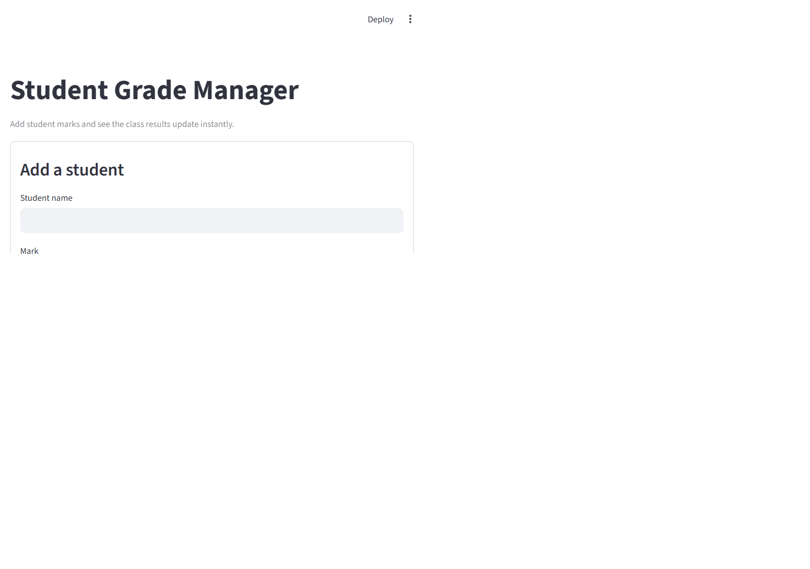
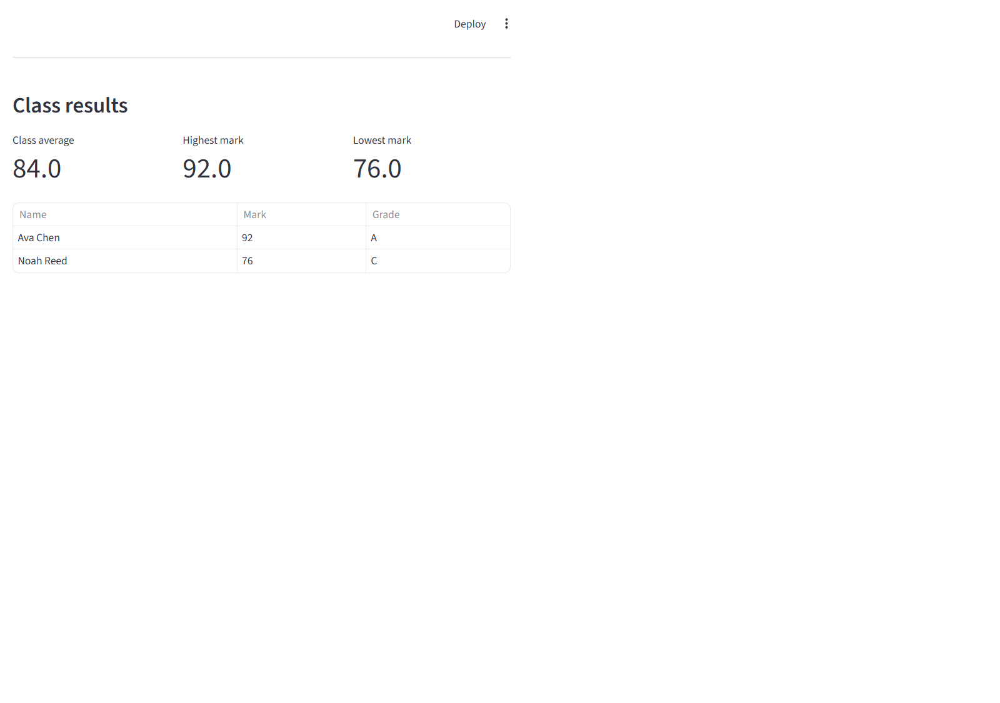

# Student Grade Manager (Streamlit)

> Add students and marks in a web form and see grades update instantly.

  

## Overview

The web version of [Student_Grade_System](https://github.com/prasanth-sundararajan/Student_Grade_System). A Streamlit form collects each student's name and mark, validates the input, assigns a letter grade and shows the class results. Records are kept in `st.session_state` so they survive Streamlit's reruns.

## Features

- Input validation (name required, mark 0 to 100)
- Grades A to E (90 / 80 / 70 / 60 thresholds)
- Live results table using session state

## Demo




## Tech stack

| Layer | Technology |
|---|---|
| UI | Streamlit |
| Language | Python |

## Project structure

```text
.
├── grade_app.py
└── requirements.txt
```

## Getting started

**Prerequisites:** Python 3.10+

```bash
git clone https://github.com/prasanth-sundararajan/Streamlit-grade-app.git
cd Streamlit-grade-app
python -m venv .venv
# Windows: .venv\Scripts\activate    macOS/Linux: source .venv/bin/activate
pip install -r requirements.txt
```

## Usage

```bash
streamlit run grade_app.py
```

## License

Released under the [MIT License](LICENSE).

## Author

**Prasanth Sundararajan**, Senior SRE and AI Engineer  
[LinkedIn](https://www.linkedin.com/in/prasanth-s-a093a7109/) · [GitHub](https://github.com/prasanth-sundararajan)
